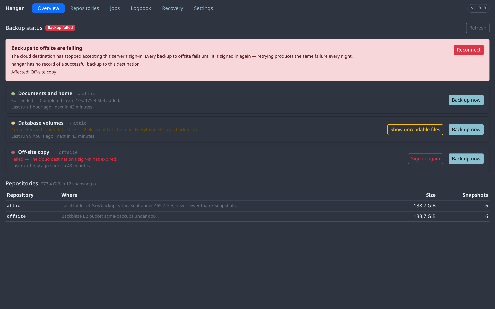
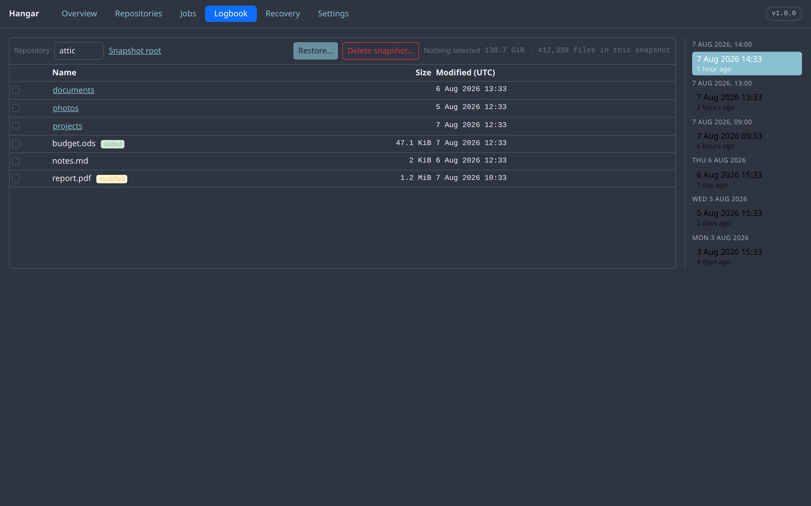
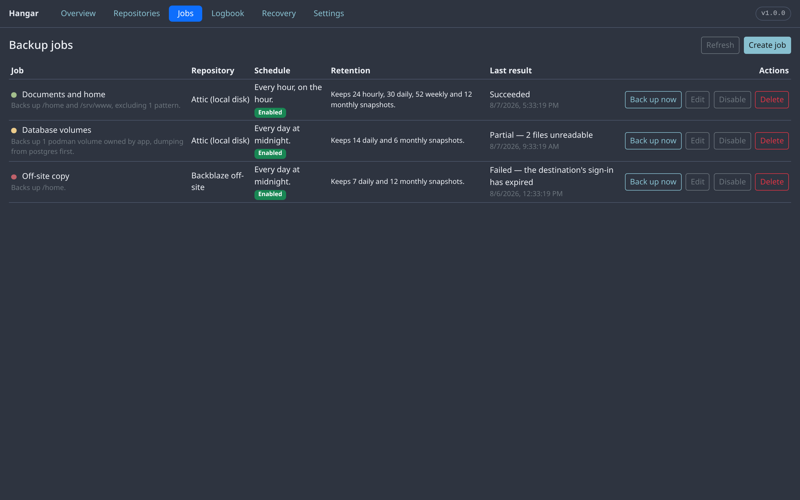
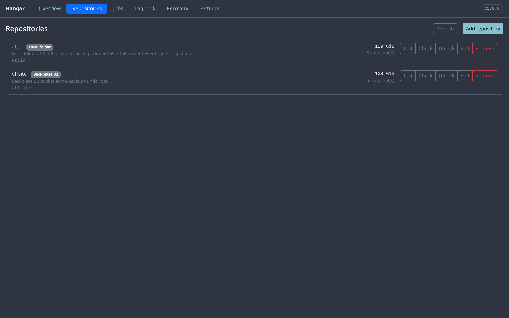
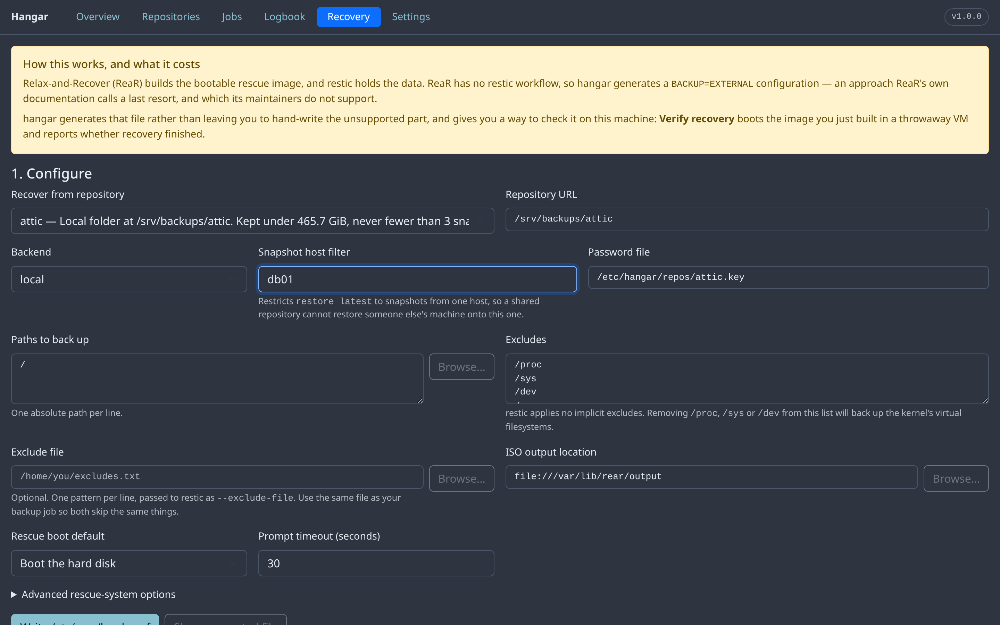
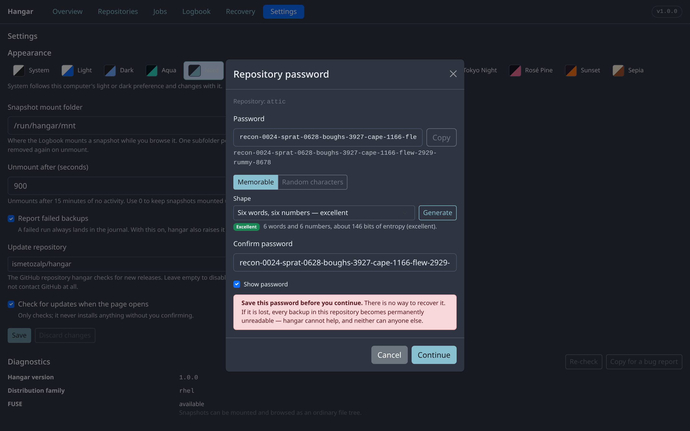
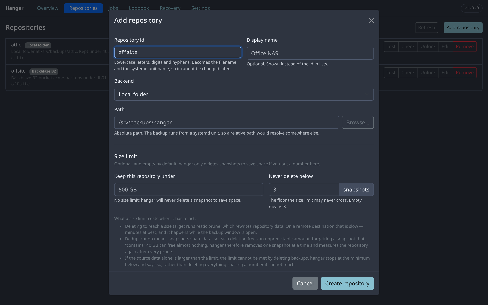
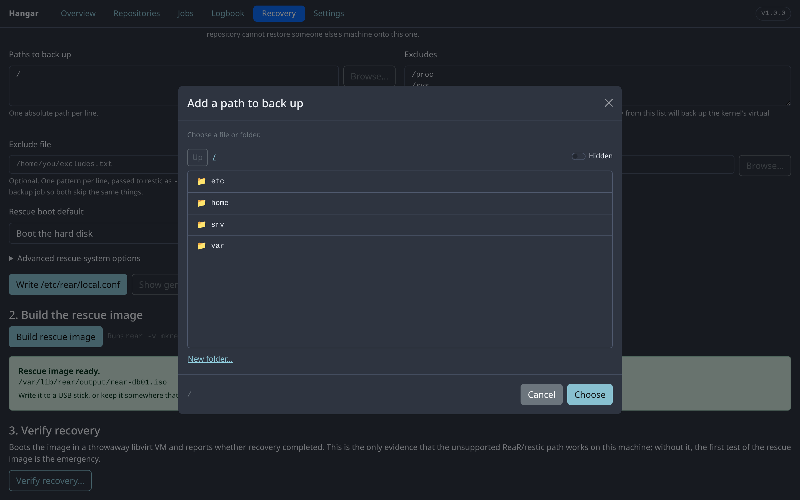
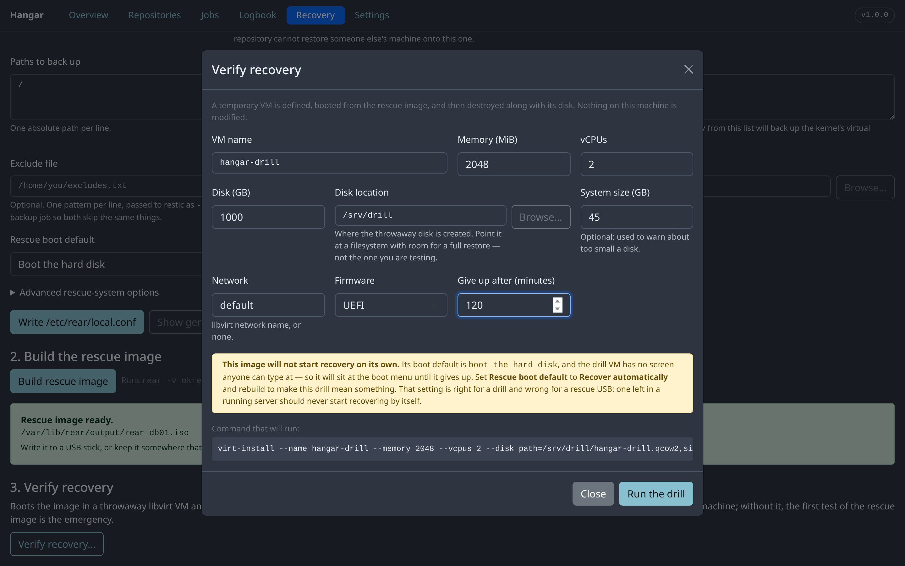
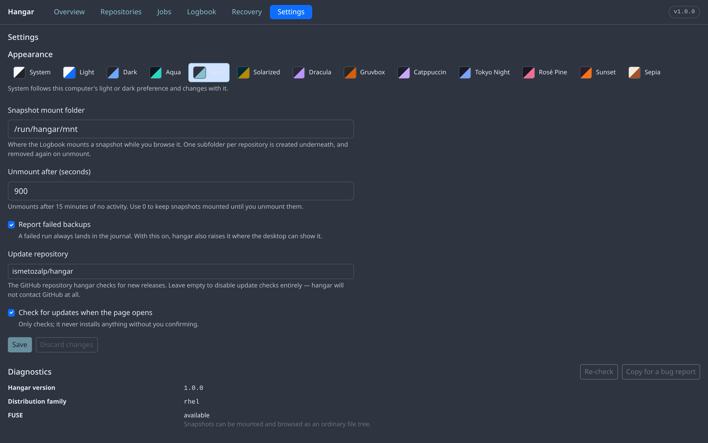

# Hangar

A Cockpit plugin for creating and managing backups.

Pick a destination, turn it on, forget about it — and when something is lost,
scroll back through the **Logbook** and take it back. Hangar adds scheduled,
deduplicated, encrypted backups with automatic retention thinning, a
point-in-time file browser, and bare-metal disaster recovery to the Cockpit web
console.

> **🗂️ Another Cockpit plugin of mine:** [**Explorer**](https://github.com/ismetozalp/explorer)
> (`ismetozalp/explorer`) — a file browser for the Cockpit console, with a two-pane
> mode, an editor and an integrated terminal. Hangar's folder pickers and restores
> land where Explorer can pick them up.
>
> **📺 And another:** [**InFlight TV**](https://github.com/ismetozalp/iftv)
> (`ismetozalp/iftv`) — an IPTV / live-TV player for the Cockpit console.
>
> **📊 And another:** [**ctop**](https://github.com/ismetozalp/ctop) (`ismetozalp/ctop`) —
> a live system/process monitor for the Cockpit console.
>
> **⬇️ And another:** [**Manifest**](https://github.com/ismetozalp/manifest) (`ismetozalp/manifest`) —
> a download manager for the Cockpit console (torrents, magnets, HTTP/FTP/Metalink via a
> per-user `aria2c`).
>
> **🖥️ And another:** [**Pilot**](https://github.com/ismetozalp/pilot) (`ismetozalp/pilot`) —
> installs and manages a self-hosted [RustDesk](https://rustdesk.com/) remote-desktop server
> (`hbbs`/`hbbr` plus an API control plane) from the Cockpit console.

Cockpit has never shipped a backup UI. Upstream has
[said as much](https://github.com/cockpit-project/cockpit/discussions/16302):
*"It's not like we'd say 'no' to a backup UI (in fact, I think it'd be great to
have one!) — it's just that there is none right now."* Hangar is that.

---

## What it does

**Scheduled backups.** Jobs run from systemd timers with `Persistent=true`, so a
run missed while the machine was asleep fires when it wakes.

**Automatic thinning.** The **Rolling** retention preset keeps 24 hourly, 30
daily, 52 weekly and 12 monthly snapshots, grouped per host and path. Old
snapshots age out on their own; you never manage them by hand.

**The Logbook.** Scroll back through every moment your data was captured and
browse the filesystem exactly as it was. This is a real
[FUSE](https://en.wikipedia.org/wiki/Filesystem_in_Userspace) mount of the
snapshot, not a reconstruction — so it is an ordinary directory tree, and
restoring a file is copying it. Change badges show what was added, modified or
removed between adjacent snapshots.

**Anywhere for a destination.** Local disk, USB, SFTP, a REST server, Amazon S3,
Backblaze B2, Azure, Google Cloud Storage, or any
[rclone](https://rclone.org/overview/) remote — which covers most of the rest.

**Bare-metal recovery.** Hangar builds a bootable rescue image with
[ReaR](https://relax-and-recover.org/) that restores the whole system, to new
hardware if necessary, from the same repository your files live in.

**Verify recovery.** A rescue image you have never tested is a guess. Hangar can
boot yours in a throwaway libvirt VM and prove the restore completes — before
you need it.

**Turnkey.** Hangar installs what it needs. It never tells you to go and run a
package manager.

---

## What it looks like



*Overview — one screen that says whether your backups are fine. A job that
succeeded, one that finished with unreadable files, and one that failed because
the cloud destination's sign-in expired, with the fix next to it.*



*The Logbook — scroll back through every captured moment and browse the
filesystem as it was. Badges mark what changed since the snapshot before it.*



*Jobs — what is backed up, where it goes, how often, and how long it is kept.*



*Repositories — every destination with its real size and snapshot count.*



*Recovery — a bootable rescue image that restores the whole machine from the
same repository your files live in. The banner states the unsupported part
plainly rather than hiding it.*



*A repository password cannot be recovered, so the dialog helps you make a
strong one you can still type at a rescue console — and will not let you past it
without noticing you must store it.*



*Adding a destination — a local folder, an SFTP server, or one of sixteen cloud
providers, in one form.*



*Every path in hangar can be browsed instead of typed, as root, without leaving
the page.*



*Verify recovery — the drill. It boots the rescue image you just built in a
throwaway VM and reports whether recovery actually completed. The numbers in
this dialog matter more than they look; the section below explains why.*



*Settings — themes, how long a browsed snapshot stays mounted, how often
repository sizes are measured, and where updates come from.*

---

## Cloud destinations

Hangar speaks four object stores natively — **Amazon S3** (and S3-compatible
providers), **Backblaze B2**, **Azure Blob Storage** and **Google Cloud
Storage** — plus local disks, USB drives, SFTP and a
[restic REST server](https://github.com/restic/rest-server).

Everything else goes through [rclone](https://rclone.org/overview/), which adds
roughly forty more: **Google Drive, Dropbox, OneDrive, Box, pCloud, Mega, Proton
Drive, iCloud Drive**, Yandex Disk, Koofr, Jottacloud, Seafile, and protocols
including **WebDAV, SMB/CIFS, FTP and HDFS**.

Two things worth knowing before you choose:

**Prefer the native backend where one exists.** If you are on S3, B2, Azure or
GCS, use Hangar's own repository kind rather than routing through rclone — one
less process in the path, one less thing to fail.

**Do not add rclone's `crypt` layer.** restic already encrypts everything
client-side before it leaves the machine. Layering `crypt` underneath buys
nothing and costs CPU; your provider holds encrypted restic packs either way.

### Adding a cloud destination

Hangar can create the rclone remote for you — **Repositories → Add a cloud
destination** — so `rclone config` is not a prerequisite. How much it can do
depends on how the provider authenticates.

| Kind | Providers | What you do |
|---|---|---|
| **Credentials** | WebDAV, SFTP, FTP, SMB, S3, B2, Swift, Koofr, Mega | Fill in the form. Nothing to run elsewhere. |
| **Sign-in** | Google Drive, Dropbox, OneDrive, Box, pCloud, Yandex | Run one command on **your own computer**, paste the result back. |
| **Manual** | Jottacloud | Hangar cannot automate it — it shows you what to run. |

### Why sign-in needs a command on your own computer

`rclone authorize` starts a local web server and asks the provider to redirect
your browser to `127.0.0.1` when you approve. Run it on the server and that
redirect points at the *server's* loopback address, which your laptop's browser
cannot reach.

So Hangar shows you the exact command, you run it where your browser is, and you
paste the token back. This is rclone's own documented headless procedure, not a
workaround Hangar invented.

### Per-provider limits

These are properties of the providers, not of Hangar, and Hangar states each one
at the point where you choose:

| Provider | Limit |
|---|---|
| **Google Drive** | rclone's built-in client ID is shared by every rclone user and is **heavily rate-limited**. For anything beyond a trial, register your own in the Google Cloud console — backups will be far faster. This is the only one Hangar flags as a warning rather than a note. |
| **OneDrive** | A **OneDrive for Business** tenant may refuse rclone's built-in client ID outright. Register an app in Entra ID. |
| **Box** | The refresh token **expires after 60 days of inactivity**. A repository that is never written to will eventually need re-authorising. |
| **pCloud** | Accounts live in one of two regions. If the remote lists nothing after you authorise, the account is in the other one. |
| **Dropbox, Yandex** | Shared-key rate limits and per-application quotas. Your own app registration avoids them; the built-in one is usually fine for modest backups. |
| **Jottacloud** | Works as a destination, but **Hangar cannot create the remote.** rclone has no `authorize` flow for it — verified, not assumed: `rclone authorize jottacloud` answers *"not supported by this backend"*. Generate a personal login token in Jottacloud's web interface, run **interactive** `rclone config` once, and Hangar will pick the remote up. Note that the non-interactive `rclone config create <name> jottacloud` **appears to succeed but leaves a remote with no token** — it will show up in Hangar's list and fail at backup time. Use interactive `rclone config`. |


## Recovering a whole machine, in practice

Everything below was learned by running the drill against real hardware until it
worked — a 1 TB NVMe machine restored from an SFTP repository on a NAS. None of
it is theory, and most of it is not in ReaR's documentation in one place.

### Size the drill disk like the original disk, not like the data

The single most surprising lesson. ReaR recreates the **recorded partition
table**, so a machine whose disk was 1 TB needs a 1 TB target — even if only
45 GB is actually used. Give it less and recovery stops early:

```
Last partition /dev/sda3 must shrink by 935780679680 bytes to still fit on device
ERROR: Last partition /dev/sda3 cannot shrink (new device more than 2% smaller,
       see AUTOSHRINK_DISK_SIZE_LIMIT_PERCENTAGE)
```

The drill disk is sparse, so a 1000 GB disk costs only what the restore writes.
In our run: **1000 GB requested, 47 GB actually consumed.**

Set **System size (GB)** to roughly what a restore will write, and hangar warns
you before the drill starts rather than twenty minutes in.

### Raising the shrink limit is not the fix it appears to be

`AUTOSHRINK_DISK_SIZE_LIMIT_PERCENTAGE` (in *Advanced rescue-system options*)
lets ReaR shrink **only the last partition**. If that partition holds LVM, the
volumes inside are still recreated at their recorded sizes. A layout with a
70 GiB root LV cannot be restored onto a 60 GB disk however high you set it:
ReaR retries the first oversized volume with `-l 100%FREE` and every volume
after it then fails. ReaR's own documentation is blunt — a substantially smaller
disk needs a hand-adapted `disklayout.conf`.

It earns its place for the real case it was designed for: a replacement disk a
few percent smaller than the original, which two vendors' "1 TB" drives usually
are, and which ReaR's 2% default is enough to refuse.

### Put the drill disk somewhere with room

The libvirt default pool lives on `/`, which is usually the filesystem you are
testing — and by definition too small to hold a copy of itself. Point **Disk
location** at something roomier. hangar passes `--check disk_size=off` because
libvirt judges a sparse disk as if fully allocated, which for a drill measures
the wrong thing.

### UEFI: Secure Boot off, and q35

A ReaR rescue image is not signed by any key your firmware trusts. Boot it with
Secure Boot on and it dies at the bootloader with `Access Denied`. hangar asks
for the firmware feature explicitly rather than the `uefi` shorthand, which
quietly selects a secure-boot firmware — and asks for the `q35` machine type,
because every EFI firmware descriptor is q35-only.

### The rescue menu reads different settings on BIOS and UEFI

`ISO_DEFAULT` and `USER_INPUT_TIMEOUT` steer the **syslinux** menu, which is what
a BIOS machine boots. A UEFI machine boots **GRUB2**, which reads
`GRUB2_DEFAULT_BOOT` and `GRUB2_TIMEOUT` instead. A config carrying only the
first pair boots a UEFI machine straight past the rescue system and into the
disk it was meant to rebuild. hangar writes both.

Likewise `auto_recover`, the option that actually starts an unattended restore,
is added by ReaR only while writing the syslinux menu. On UEFI it has to be put
on the kernel command line by hand, or the rescue system boots to a login prompt
and waits forever.

### Restoring over SSH: ReaR removes the key you need

For an SFTP repository the rescue system needs root's private key, and ReaR
removes it **twice over**:

- `SSH_FILES` defaults to `avoid_sensitive_files`, which copies `authorized_keys`
  and `known_hosts` and no private keys at all.
- Even when the key is copied, `build/default/501_check_ssh_keys.sh` deletes any
  private key that has **no passphrase**, because `SSH_UNPROTECTED_PRIVATE_KEYS`
  defaults to `no`.

Both defaults are sensible for an image someone might leave in a drawer, and
neither can be satisfied by an unattended restore — which cannot type a
passphrase, so the key it needs is necessarily unprotected. hangar sets both for
SFTP repositories. Without them the recovery stops at a prompt no one can answer:

```
Running external restore command
sshd@nas's password:
```

**The finished rescue image is a credential.** It contains your repository
password and, for SFTP, a key that can log into your backup server. Treat the
ISO like the password it carries.

### What a successful drill looks like

```
Running external restore command
Finished external restore command
Running dracut...
Updated initrd with new drivers for kernel 6.12.0-….x86_64.
Creating EFI Boot Manager entries...
Finished 'recover'. The target system is mounted at '/mnt/local'.
'rear recover' finished successfully
```

hangar reports **Recovery completed in the drill VM**, quoting the line it
found, then shuts the guest down and removes it.

`Updated initrd with new drivers` is the line worth looking for. A restore can
put every file back and still leave a machine that will not boot on its own; an
initrd rebuilt inside the restored system is what tells you the difference. If
dracut fails there instead, check that your snapshot really contains
`/usr/lib/modules` — a restore cannot build an initrd out of modules the backup
never captured.

Some noise along the way is normal and not failure:

- `/mnt/local/etc/rear/local.conf: FAILED` — ReaR comparing restored files
  against the rescue system. If you changed the config after your last backup,
  the restored copy genuinely differs. It is an accurate observation, not an error.
- `Warning: Unmaintained driver is detected`, `Error: Driver 'pcspkr' is already
  registered` — virtual hardware noise from the guest.

### A quiet restore is not a stuck restore

restic loads the repository index before it writes anything. Over SFTP that is
several minutes of small reads with **no output on the console and no growth in
the disk image** — indistinguishable from a hang if you are watching either one.
On this hardware it sat at ~950 MB for several minutes, then wrote 47 GB in five
and a half.

If you want to know whether a drill is alive, watch the guest's network counter
rather than its disk:

```sh
sudo virsh domifstat hangar-drill vnet0        # rx_bytes climbing = it is working
sudo du -h /path/to/hangar-drill.qcow2         # only moves once writing starts
```

### How long it takes

Restoring ~47 GB over SFTP on a home network ran at about **75 MB/s**, roughly
ten minutes, inside a 120-minute limit. The layout recreation before it — GPT,
LVM, four filesystems — takes two to three minutes. Set **Give up after** with
your own link speed in mind; a timeout mid-restore tells you nothing.

### What has actually been tested

The drill above is not a design. Every step of it has been run end to end on
real hardware:

| | |
|---|---|
| Source machine | 1 TB NVMe, GPT + LVM, XFS on root, /home and /boot, UEFI |
| Repository | restic over SFTP, on a NAS across a home network |
| Restored | 48 GB into a rebuilt partition table and volume group |
| Restore rate | ~86 MB/s to disk, about six minutes |
| Initrd | rebuilt inside the restored system, for every installed kernel |
| Bootloader | GRUB2 installed, EFI boot entry created |
| Verdict | reported automatically, guest shut down, disk removed |

What that does **not** prove: that the restored disk boots on physical hardware
of a different shape, or that a machine with a layout unlike the one above
recovers cleanly. Run your own drill. That is the entire point of the feature —
the only rescue image worth having is one you have watched work.

### Run the drill after every change

A rescue image is only as good as its last test, and the settings that break it
are exactly the ones that look harmless. Every failure above produced a working
`local.conf` and an image that booted; the difference only showed up in a VM
that tried to use them.

---

## Requirements

- Cockpit 300 or newer
- systemd (any host running Cockpit has it)
- `restic` 0.17.0 or newer — Hangar installs it for you

Optional, installed on demand for the features that need them:

| Package | Needed for |
|---|---|
| `fuse3` | Browsing snapshots in the Logbook |
| `rclone` | Off-site destinations rclone reaches and restic does not |
| `rear` | Bare-metal rescue images |
| `libvirt` | Backing up virtual machines, and the recovery drill |

### A note on virtual machines

Hangar talks to `qemu:///system` as root, so it needs no group membership and is
unaffected by polkit. If you want to run `virsh` against the system hypervisor
*yourself*, add your account to the `libvirt` group and log back in:

```sh
sudo usermod -aG libvirt $USER
```

Without it, a read-write `virsh -c qemu:///system` command appears to hang — it
is actually waiting on a polkit prompt that nothing is there to answer.

### A note for RHEL, CentOS, Rocky and Alma

`restic` is not in the base repositories on these distributions — it lives in
[EPEL](https://docs.fedoraproject.org/en-US/epel/). If EPEL is enabled, Hangar
installs restic through PackageKit like anywhere else. If it is not, Hangar
offers the official static binary instead, showing you the release URL and its
SHA256 and asking before it downloads anything.

Debian, Ubuntu, Fedora, openSUSE and Arch all package restic directly, so
installation there is a single click.

---

## Installing

```sh
git clone https://github.com/<you>/hangar.git
cd hangar
sudo make install
sudo systemctl try-restart cockpit
```

Then open Cockpit and choose **Hangar** in the sidebar.

To remove it:

```sh
sudo make uninstall
```

Your configuration in `/etc/hangar` is deliberately left in place. Delete it
yourself if you want it gone — and note that removing Hangar does **not** stop
your backups, which is by design (see below).

---

## How it is built

Hangar has no daemon and no database. The system is the state store:

| State | Lives in |
|---|---|
| Schedule | systemd timers and units |
| Backup data and history | the restic repository |
| Job, repository and retention config | `/etc/hangar/**.json` |
| Run history and logs | journald, per unit |
| Secrets | `/etc/hangar/repos/<id>.key`, mode 0600 root:root |

The practical consequence: **uninstall Hangar and your backups keep running.**
Everything Hangar does is reproducible by hand with `systemctl`, `restic` and
`journalctl`, and nothing it manages is locked inside a format only it can read.
It is a view and an editor over system state, not an application that owns it.

The trade-off, stated honestly: Hangar cannot show you anything systemd and
restic cannot tell it. There are no cross-run analytics beyond what journald
retains.

### Layout

```
/etc/hangar/config.json          global settings
/etc/hangar/repos/<id>.json      repository definition (never secrets)
/etc/hangar/repos/<id>.key       repository password, 0600 root:root
/etc/hangar/jobs/<id>.json       job definition
/etc/hangar/dr.json              disaster recovery configuration
/var/lib/hangar/state/<id>.json  last run record, survives reboot
/run/hangar/mnt/<repo>           transient Logbook mount
/usr/libexec/hangar/hangar-run   privileged backup runner
```

---

## Why restic

Hangar drives restic entirely through its `--json` output — progress bars come
from real `percent_done` messages, not from parsing human-readable text — and
restic's exit codes are specific enough to turn a failure into a *fix*:

| Exit | Meaning | What Hangar offers |
|---|---|---|
| 3 | Some files could not be read | Lists them. **The snapshot still exists** — this is not a failure |
| 10 | Repository does not exist | Initialise it |
| 11 | Repository is locked | Unlock it |
| 12 | Wrong password | Re-prompt |

That exit-3 row matters more than it looks. A backup where three unreadable
files turn the whole run red teaches you to ignore red. Hangar records it as
*partial*, tells you which files, and moves on.

Borg was the main alternative and was rejected: its repository is single-writer
under an exclusive lock, so a scheduled run and a manual one collide; remotes
are SSH-only with borg required at the far end; and borg 2.0 is a breaking
repository-format change still in beta.

---

## Security

- Repository passwords are passed to systemd units via `LoadCredential=`, not
  through the environment and not on the command line.
- Backend credentials are exported as environment variables, never as argv, so
  they never appear in `ps` output.
- Repository ids are validated to `[a-z0-9-]` before becoming filenames or
  systemd unit names, so path traversal is rejected at the boundary.
- restic repositories are always encrypted; there is no unencrypted mode to
  misconfigure.

Anyone with root can read the repository password. That is an accepted
trade-off — root can already read everything being backed up — and the secret
handling is isolated in one module so TPM-bound storage can replace it later.

---

## Testing

```sh
npm install          # only for the Playwright-based UI tests
make test            # unit tests with a coverage report and its floors
npm run test:unit    # the same tests, no coverage, for a fast inner loop
make coverage        # writes COVERAGE.html and coverage/lcov.info
npm run test:smoke   # structural checks on the shipped plugin
npm run test:integration   # real restic against a temp repository
npm run test:e2e     # Playwright, against a stubbed cockpit bridge
npm run test:ui      # Playwright, inside a real Cockpit session
```

### Coverage

`make test` measures line, branch and function coverage over `js/` and fails if
it drops below the floors in the Makefile — floors set a shade under what the
suite achieves today, so code that arrives untested turns the run red instead of
quietly moving the number down.

`make coverage` writes two files. `coverage/lcov.info` is the machine copy for
editors and is not committed. **`COVERAGE.html`** is the human one that is: one
row per source file, sortable by any column, opening worst-first. It is HTML
rather than Markdown because a Markdown table cannot sort, which means GitHub
shows it as source — open it from a checkout. It records percentages only; line
numbers would make it churn on every insertion above them, and a report that
changes when the testing did not is a report people stop reading.

The figure covers the browser sources and nothing else. `libexec/hangar-run` is
about 2200 lines of Python, driven end to end by the integration suite and
invisible to node's instrumentation; the report names that omission rather than
letting one number imply more than it measures.

The integration suite runs a real restic binary against a throwaway local
repository and asserts the round trip: backup, thin, restore, byte-for-byte
comparison — plus the exit-code contracts the entire UI depends on. It skips
cleanly when restic is not installed.

`test:e2e` drives the plugin against a **stubbed** cockpit bridge: fast, needs no
Cockpit, and blind to everything only the real bridge does. `test:ui` logs into a
running Cockpit and drives the same screens through the real one. That
distinction is not academic — the stub answered every call the folder picker made
while the picker listed nothing at all on a real machine, because
`cockpit.spawn`'s text channel discards output containing NUL bytes and the stub
happily carried them. It needs credentials and skips (exit 2) without them:

```sh
COCKPIT_PASS=… npm run test:ui        # or COCKPIT_URL / COCKPIT_USER
```

Rather than passing a password on every command line, point
`COCKPIT_CREDENTIALS_FILE` at a JSON file **outside the repository**, so it can
never be committed:

```sh
export COCKPIT_CREDENTIALS_FILE="$HOME/cockpit-credentials.json"
```

```json
{
  "host": "https://localhost:9090",
  "user": "your-login",
  "password": "your-password"
}
```

`chmod 600` it. When the variable is unset, `~/cockpit-credentials.json` is used
if it exists. Environment variables win over the file, so `COCKPIT_PASS=…` still
overrides it for a one-off run. With neither, the suite **skips** rather than
fails — a missing password is not a broken plugin.

---

## Known limitations

Stated plainly, because a backup tool that oversells itself is worse than one
that does less.

**Disaster recovery rests on an unsupported path.** Upstream ReaR has no restic
workflow. Hangar generates a `BACKUP=EXTERNAL` configuration, which ReaR's own
documentation calls a last resort, and upstream will not support it. This is
exactly why the recovery drill exists — **build the rescue image and verify it
before you need it.** An untested rescue image is a guess.

**Backing up a running database's files can produce a backup that will not
restore.** Hangar warns when a container that looks like a database is backed up
with consistency `none`, but no warning makes a live copy safe. For databases
use `stop`, or `command` with a real dump (`mongodump`, `pg_dump`).

**VM quiesce mode `agent` degrades silently.** It needs `qemu-guest-agent`
running *inside* the guest. Without it the freeze fails and the copy is only
crash-consistent — and nothing in the guest tells you that.

**`none` quiesce is crash-consistent at best.** It is the fast option, not the
safe one. Whether that is acceptable depends entirely on what the VM runs.

**One machine.** Hangar manages the host it runs on. Cockpit's host switcher has
been deprecated and disabled by default since Cockpit 322, for sound security
reasons, so Hangar deliberately does not build on it. If you want several
machines in one view, point them all at **one shared restic repository** —
concurrent writers are safe and every snapshot records its hostname, so the
aggregation happens in the data rather than in the browser.

**Jottacloud cannot be configured from Hangar**, and several cloud providers
carry rate limits that are not Hangar's to fix. See
[Per-provider limits](#per-provider-limits).

**restic and rclone are not Red Hat–supported on RHEL.** They live in EPEL. Only
ReaR ships in RHEL AppStream proper. For a homelab this is irrelevant; for a
supported production estate it is a procurement question worth asking first.

**No cross-run analytics.** Hangar has no database, so it can only show what
systemd and restic can tell it. Once journald rotates, that history is gone.

## Licence

See [LICENSE](LICENSE).
